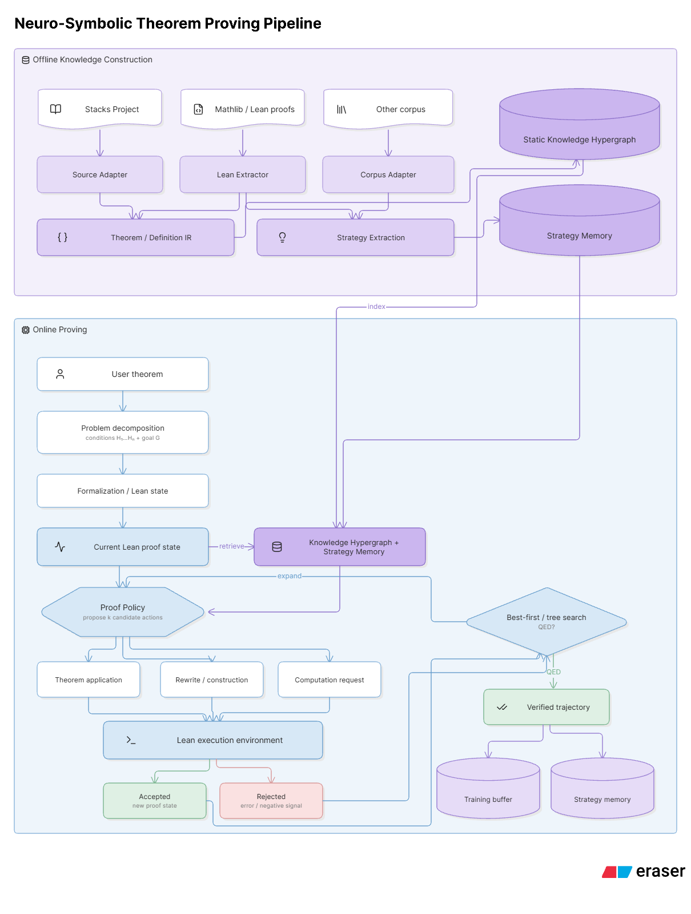

# AI4Algebra

A verifier-guided mathematical reasoning agent. AI4Algebra converts informal mathematical knowledge into a typed theorem hypergraph, learns reusable proof strategies from prior proofs, searches for proof paths under explicit preconditions, and uses Lean 4 as the final correctness oracle.

## Motivation

Large language models can propose mathematical arguments but cannot be trusted to verify them. Formal proof assistants can verify arguments but cannot find them at scale. AI4Algebra is built around a strict division of labor between the two:

- The LLM proposes: decomposition of a theorem into typed conditions and goals, candidate formalizations, and high-level proof strategies.
- The knowledge hypergraph constrains: theorems are stored as executable, precondition-aware inference rules rather than ordinary graph edges, so a rule can only fire when its premises, variable instantiations, and side conditions are actually satisfied.
- Lean 4 executes and certifies: every proof step is checked by the Lean kernel, so correctness never depends on trusting the model.
- SageMath and GAP serve as computational oracles: they discover certificates (factorizations, Groebner bases, counterexamples in finite structures) which are then converted into Lean-checkable form. Sage computes; Lean certifies.

## Design principles

1. Three graph structures, kept separate: a static source dependency graph (Stacks Project citations), a semantic theorem hypergraph (the core contribution), and the dynamic Lean proof tree, which is the authoritative proof search space.
2. Theorems are typed hyperedges. A theorem maps a set of typed premises to conclusions under variable substitution and side-condition constraints, not a single arrow between two statements.
3. Statement correctness and proof correctness are evaluated separately. A Lean-accepted proof of a mistranslated statement is not a result.
4. Embeddings retrieve candidates; they never certify equivalence. Formal equivalence is established only by Lean.
5. Strategy memory is a real database. Proof strategies carry applicability signatures, verified examples, and empirical success statistics, and are promoted only after reuse and verification.
6. Verifier-guided expert iteration comes before reinforcement learning, and best-first search comes before MCTS.

## Roadmap

The first milestone is a small but completely closed loop: a modest set of mathlib theorems and Stacks Project records, a typed intermediate representation, hypergraph retrieval with precondition matching, machine-oriented Lean execution, an LLM proof policy, best-first search, and episodic plus strategy memory. Computational oracles, local model training, and progressively more serious commutative algebra and algebraic geometry follow only after the closed loop works end to end.

A curated benchmark of Stacks Project results with gold formalizations and dependency-aware evaluation splits is planned as a named artifact of the project.

## Architecture

## Status

Early stage. This repository currently holds the project charter only; implementation has not yet been committed.

## Contributors

- Jacky (Yuqing) Jiang ([JackyJiang08](https://github.com/JackyJiang08))
- [UnbeliverpoolJaychou](https://github.com/UnbeliverpoolJaychou)

## License

MIT
