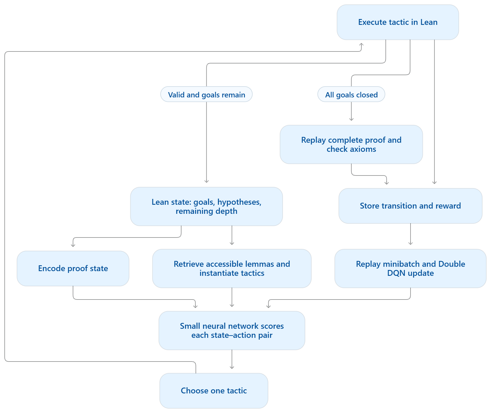

# AI4Algebra

A verifier-guided mathematical reasoning agent. AI4Algebra converts informal mathematical knowledge into a typed theorem hypergraph, learns reusable proof strategies from prior proofs, searches for proof paths under explicit preconditions, and uses Lean 4 as the final correctness oracle.

## Motivation

Large language models can propose mathematical arguments but cannot be trusted to verify them. Formal proof assistants can verify arguments but cannot find them at scale. AI4Algebra is built around a strict division of labor between the two:

- The LLM proposes: decomposition of a theorem into typed conditions and goals, candidate formalizations, and high-level proof strategies.
- The knowledge hypergraph constrains: theorems are stored as executable, precondition-aware inference rules rather than ordinary graph edges, so a rule can only fire when its premises, variable instantiations, and side conditions are actually satisfied.
- Lean 4 executes and certifies: every proof step is checked by the Lean kernel, so correctness never depends on trusting the model.
- SageMath and GAP serve as computational oracles: they discover certificates (factorizations, Groebner bases, counterexamples in finite structures) which are then converted into Lean-checkable form. Sage computes; Lean certifies.

## Design principles

1. Three graph structures, kept separate: a static source dependency graph (Stacks Project citations), a semantic theorem hypergraph (the core contribution), and the dynamic Lean proof tree, which is the authoritative proof search space.
2. Theorems are typed hyperedges. A theorem maps a set of typed premises to conclusions under variable substitution and side-condition constraints, not a single arrow between two statements.
3. Statement correctness and proof correctness are evaluated separately. A Lean-accepted proof of a mistranslated statement is not a result.
4. Embeddings retrieve candidates; they never certify equivalence. Formal equivalence is established only by Lean.
5. Strategy memory is a real database. Proof strategies carry applicability signatures, verified examples, and empirical success statistics, and are promoted only after reuse and verification.
6. Verifier-guided expert iteration comes before reinforcement learning, and best-first search comes before MCTS.

## Roadmap

The first milestone is a small but completely closed loop: a modest set of mathlib theorems and Stacks Project records, a typed intermediate representation, hypergraph retrieval with precondition matching, machine-oriented Lean execution, an LLM proof policy, best-first search, and episodic plus strategy memory. Computational oracles, local model training, and progressively more serious commutative algebra and algebraic geometry follow only after the closed loop works end to end.

A curated benchmark of Stacks Project results with gold formalizations and dependency-aware evaluation splits is planned as a named artifact of the project.

## Architecture



## Status

The real Lean loop has produced an independently verified two-step proof of
`a * (b * b⁻¹) = a` in a group. See the [generated proof](runs/elementary-search-smoke/proof.lean)
and [audit result](runs/elementary-search-smoke/verdict.json). All four curated elementary
reference certificates also pass verification. The real training/evaluation loop and
curated Stacks pilot are implemented and tested; the separate synthetic DDQN baseline
stays runnable. A live Astra/high proposal also proved the group identity in one
Lean-verified step; its [proof and outcome](records/succeeded/turn-20261125-openai-smoke/group-inverse-identity/attempt-001/outcome.md)
record USD 0.020264 in API usage and an independently accepted offline replay.

Final offline checks passed 348 tests, strict mypy and Ruff. Elementary validation and
test each proved their one task in all six seed/policy trials. The Stacks training
subclaim was verified, but both harder held-out tasks exhausted their fixed probe
budgets. These small results do not establish a learned or retrieval advantage.

Implementation follows [RETRIEVAL_DDQN_PLAN.md](RETRIEVAL_DDQN_PLAN.md):
elementary group/ring exercises first, then curated Stacks Project statements. See the
[requirements](docs/proposal.md), [detailed design](docs/detailed-design.md),
[module progress](docs/tasks/progress.md), and [implementation prompt](docs/prompt.md).
Offline proof training needs no API key. The local `.env` now enables authorized
GPT-6.2 Astra/high proposals, limited to USD 0.50 per assistant turn through one
shared paid run/ledger. `.env.example` keeps safe offline defaults and blank credentials.
`configs/lean-live-smoke.json` defines a bounded paid smoke configuration. Retrying
within a turn must retain the same ledger; never start another paid run to reset it.

### Selected group theory benchmark

The ten newly selected group theory exercises have a separate
[reference-check and structural-search benchmark](docs/selected-group-benchmark.md).
It preserves the supplied solution manual and distinguishes checked reference proofs
from autonomous search outcomes; it does not claim new DDQN training results.
Exercise 11 also has a [full retrieval/DDQN procedure](docs/exercise11-full-system.md),
with a separate bootstrap exercise, trained checkpoint and independently audited
target search. Future requested tests use the full system under `AGENTS.md`.

### Optional retrieval API benchmark

Stacks Project tag lookup, LeanExplore semantic search, and Loogle declaration search
have a separate [benchmark and setup guide](docs/retrieval-api-benchmark.md).
Their current endpoints need no API key. Nine cases and endpoint/timeout settings
are provided; network access requires an explicit `--live` command. Stacks live use
is disabled pending the maintainer coordination requested by its API documentation.

```powershell
uv run python -m ai4algebra.api_benchmark --queries configs/retrieval-api-benchmark.json --output runs/retrieval-api-dry/report.json
```

### Development setup

The proof-loop Python package uses `src/ai4algebra` to avoid a Windows filename
collision with the Lean `AI4Algebra` directory. Build the native Lean workers before
running the real proof tests.

```powershell
python -m pip install uv==0.13.10
uv sync --locked --group dev --extra test
lake build
uv run pytest -q
uv run mypy --strict src/ai4algebra retrieval_ddqn tests
uv run ruff check src/ai4algebra retrieval_ddqn tests
uv run ruff format --check src/ai4algebra retrieval_ddqn tests
```

If OneDrive prevents updating an existing environment, use a fresh environment
outside the synchronized directory before running the same commands:

```powershell
$env:UV_PROJECT_ENVIRONMENT = Join-Path $env:LOCALAPPDATA 'AI4Algebra/venv-copy'
```

The uv configuration uses copied files to avoid cloud filesystem hardlink failures.
Keep `lean-toolchain` and `lake-manifest.json` pinned; no Lean upgrade is needed.

### Prove an elementary exercise

After the setup above, this command searches for the distributive ring identity
`a * (b - c + d) = a * b - a * c + a * d`:

```powershell
uv run python -m ai4algebra corpus-check --offline
uv run python -m ai4algebra solve --offline --task ring-distribute-sub --output runs/ring-example --max-candidates 8 --max-steps 4 --probes-per-node 1 --step-timeout-seconds 120 --task-timeout-seconds 600
uv run python -m ai4algebra verify --offline --task ring-distribute-sub --certificate runs/ring-example/result/certificate.json --output runs/ring-replay
```

Use `group-inverse-identity` for `a * (b * b⁻¹) = a`. Each successful search exports
`proof.lean`, `certificate.json`, `verdict.json` and `search.json` in its `result`
directory. A verified result means that fresh Lean replay established the original
curated statement and passed the configured axiom/dependency checks. The source-to-Lean
mapping has separate curation evidence; a successful proof alone does not establish that
an informal translation is faithful.

An unsuccessful search writes `stuck.json` beside `search.json`. It shows the reason,
last active state, saved frontier states, open goals and local hypotheses, and the
tactics and probes already tried. A failure before Lean observes a goal has no saved state.

`--offline` overrides provider settings in `.env` and needs no credentials. For paid
tactic proposals, enter your own `OPENAI_API_KEY` locally in `.env` and omit `--offline`.
The selected model is `gpt-6.2-astra` with high reasoning. One durable ledger reserves
at most USD 0.50 across all tasks and retries in a run, including unresolved requests.
Use one paid run per assistant turn. Older archived configurations above USD 0.50
are rejected by the stricter loader; preserve them as historical evidence and use
the current configuration files for new work.
Keep the same output directory and run ID when retrying that run. Local Lean and the
public Stacks source need no API keys. Live API validation is pending a configured key.

### Train and evaluate the elementary loop

The following reproduces the small two-seed training setup. It uses one verified
warmup episode followed by one DDQN rollout per seed. Keep validation and test outputs
separate; evaluate fixed checkpoints without changing their weights or return memory.

```powershell
foreach ($seed in @(7, 11)) {
  uv run python -m ai4algebra train --offline --config configs/lean-elementary.json --task group-inverse-identity --seed $seed --warmup-episodes 1 --episodes 1 --batch-size 2 --updates-per-episode 2 --probes-per-node 2 --stop-on-closure --output "runs/example-train-$seed"
}
uv run python -m ai4algebra evaluate --offline --config configs/lean-elementary.json --training-run runs/example-train-7 --training-run runs/example-train-11 --split validation --probes-per-node 2 --stop-on-closure --output runs/example-validation
uv run python -m ai4algebra evaluate --offline --config configs/lean-elementary.json --training-run runs/example-train-7 --training-run runs/example-train-11 --split test --probes-per-node 2 --stop-on-closure --output runs/example-test
```

Training saves the exact collected transitions/features, optimizer records, checkpoint
and frozen return memory. New plans use Huber loss to limit the influence of large
temporal-difference errors. The learner scores successor candidates in batches, and
the runtime reuses Lake's environment setup across fresh Lean processes.
Evaluation compares deterministic, DDQN and DDQN-with-return
retrieval under the same limits. Results include proof outcomes, actual Lean requests,
known token charges, unresolved reservations and descriptive differences across seeds.
This tiny benchmark cannot establish general performance or a retrieval advantage.

Use a fresh directory for a new training experiment. Checkpoints are evaluation artifacts;
partial training is not resumable. Concurrent writers to one output directory are rejected.
The Stacks pilot uses the same loop with pinned sources and curated mappings. It does not
automatically translate arbitrary Stacks pages into Lean.

### Export local training tactics

The [subgroup and homomorphism collection](data/training/subgroups/README.md)
includes 11 worked exercises with Lean statements, reference proofs and ordered
tactic annotations in a local JSONL file.

```powershell
uv run python -m ai4algebra export-tactics --include-selected --output runs/training-lean-solutions
uv run python -m ai4algebra export-tactics --manifest data/manifests/stacks-pilot.json --output runs/training-lean-solutions
```

These offline commands save the reviewed Lean proof bodies with their declaration,
source hash and line number. The elementary and Stacks files contain validated training
tasks. The optional selected development file includes the ten exercise proofs and their
local helper theorems. Search, premise retrieval and training have no reader for these
inspection files. The proof bodies preserve Lean tactic blocks, nested tactics and term proofs.

### Curated Stacks pilot

The pilot pins the official source to commit
`a04446e57ec1fbc252a871afcec7752fb2807b14`. Its
[selection report](data/manifests/stacks-selection.json) records nine reviewed tags,
six exclusions and these three admitted tasks:

| Task | Split | Source coverage |
|---|---|---|
| `stacks-00E5-image` | Train | Image-on-points subclaim of [00E5](https://stacks.math.columbia.edu/tag/00E5); excludes the homeomorphism and inverse |
| `stacks-00GJ` | Validation | Full [00GJ](https://stacks.math.columbia.edu/tag/00GJ), finite generation over a finite ring extension |
| `stacks-05CI` | Test | Full [05CI](https://stacks.math.columbia.edu/tag/05CI), composition of universally injective maps |

The protected reference certificates pass fresh Lean audit. Autonomous search also
verified the training subclaim, producing three transitions and two DDQN optimizer
updates. On both full held-out statements, all three policies exhausted the fixed
probe budget without a proof. To inspect the public catalog:

```powershell
uv run python -m ai4algebra corpus-check --offline --manifest data/manifests/stacks-pilot.json
```

To reproduce the bounded Stacks smoke, train from one verified warmup trajectory,
then evaluate the fixed checkpoint on validation before test:

```powershell
uv run python -m ai4algebra train --offline --manifest data/manifests/stacks-pilot.json --config configs/lean-stacks-pilot.json --task stacks-00E5-image --seed 7 --warmup-episodes 1 --episodes 0 --batch-size 2 --updates-per-episode 2 --probes-per-node 2 --stop-on-closure --output runs/stacks-example
uv run python -m ai4algebra evaluate --offline --manifest data/manifests/stacks-pilot.json --config configs/lean-stacks-pilot.json --training-run runs/stacks-example --split validation --probes-per-node 2 --stop-on-closure --output runs/stacks-example-validation
uv run python -m ai4algebra evaluate --offline --manifest data/manifests/stacks-pilot.json --config configs/lean-stacks-pilot.json --training-run runs/stacks-example --split test --probes-per-node 2 --stop-on-closure --output runs/stacks-example-test
```

Normal runs use the checked-in public metadata and curated statements. Raw source proofs
are kept outside the runtime corpus. To independently reproduce the pinned source metadata,
obtain the official Git checkout with that commit and its blobs available, then run:

```powershell
$env:AI4ALGEBRA_TEST_STACKS_CHECKOUT = 'C:/path/to/stacks-source'
uv run pytest -q -p no:cacheprovider tests/unit/test_stacks.py
```

The importer reads immutable Git objects, rejects source mismatches and distinguishes
theorem tags from section headings and list items. The optional real-checkout test skips
when this path is unset; its fixture-based importer tests remain part of the offline suite.

## Contributors

- Jacky (Yuqing) Jiang ([JackyJiang08](https://github.com/JackyJiang08))
- [UnbeliverpoolJaychou](https://github.com/UnbeliverpoolJaychou)

## License

Project code: MIT. Stacks-derived records retain the upstream attribution and
GFDL-1.2-or-later terms; see [Stacks notice](data/manifests/sources/STACKS_NOTICE.txt)
and [upstream license](data/manifests/sources/STACKS_COPYING).

## Experimental retrieval-guided Double DQN

An isolated NumPy baseline now exercises replay, Double DQN, causal retrieval,
checkpointing, and frozen evaluation on a synthetic left/right chain task. It is
not integrated with Lean proof search and does not establish mathematical proof
capability or retrieval performance gains. The chain observation is one-hot;
actions move left/right; reaching the rightmost state gives +1, other steps cost
0.01, and the configured time limit truncates an episode.

From the repository root (PowerShell):

```powershell
python -m venv .venv
.\.venv\Scripts\python.exe -m pip install -e '.[test]'
.\.venv\Scripts\python.exe -m pytest -q
.\.venv\Scripts\python.exe -m retrieval_ddqn.train --config configs/smoke.json --output runs/retrieval
.\.venv\Scripts\python.exe -m retrieval_ddqn.evaluate --checkpoint runs/retrieval/checkpoint.json --episodes 10 --seed 101
.\.venv\Scripts\python.exe -m retrieval_ddqn.train --config configs/smoke.json --output runs/baseline --disable-retrieval
.\.venv\Scripts\python.exe -m retrieval_ddqn.evaluate --checkpoint runs/baseline/checkpoint.json --episodes 10 --seed 101
```

Training writes `checkpoint.json` and `train_metrics.json`; evaluation prints JSON
and never updates the checkpoint or memory. Checkpoints are evaluation artifacts,
not resumable training snapshots (replay and RNG state are not saved). Retrieval
averages nearby state/action returns from completed training episodes, blends them
with network action scores, and falls back to the network without eligible matches.
Time-limit transitions bootstrap in DDQN; their entire truncated episodes are excluded from return memory.
See [the archived synthetic plan](docs/history/retrieval-ddqn-synthetic-baseline.md) for contracts, ownership, causal
filters, numerical verification, review findings, and recorded smoke results.
